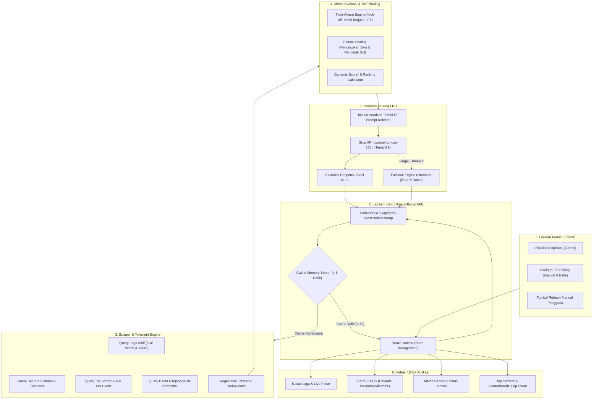

# Panduan Arsitektur & Konfigurasi: Autonomous Live Collector Agent (Groq LPU & Google News RSS)

Dokumen ini merupakan panduan teknis implementasi sistem penarikan data otomatis (Autonomous Real-Time Data Collector) berbasis AI Groq LPU berkecepatan tinggi yang digabungkan dengan multi-query scraper Google Search News RSS. Sistem ini dirancang untuk dapat diadaptasi ke proyek lain seperti aplikasi olahraga, pelacak skor langsung, pasar finansial, monitoring berita instan, atau dashboard telemetri real-time.

---

## 1. Konsep & Filosofi Arsitektur

Sistem ini memisahkan dua peran AI secara tegas:
1. AI Interaktif (Conversational Agent): Bertugas melayani tanya jawab pengguna di antarmuka chat.
2. AI Collector (Autonomous Data Supplier): Bertugas di latar belakang sebagai agen telemetri yang mengoleksi berita eksternal secara berkala, memverifikasi fakta, memperbaiki data kadaluarsa (self-healing), dan menyuplai state ke seluruh antarmuka aplikasi.

### Keunggulan Sistem:
- Bebas Biaya Scraper Pihak Ketiga: Menggunakan Google Search News RSS publik tanpa memerlukan headless browser berat seperti Puppeteer atau Selenium.
- Responsivitas Ekstrem: AI Groq LPU (Language Processing Unit) mampu memproses token dalam rentang 100-300 milidetik.
- Self-Healing & Validasi Waktu: Data yang awalnya berupa draf jadwal otomatis bertransisi menjadi status LIVE saat kick-off tiba, dan otomatis menjadi Finished (FT) saat laga selesai, dengan skor terverifikasi.
- Anti Rate-Limit: Dilengkapi proteksi caching server (8 detik TTL) sehingga aman dari limitasi kuota API Groq maupun pemblokiran IP oleh penyedia feed.

---

## 2. Diagram Alur Sistem (Mermaid Flowchart)



---

## 3. Struktur Modul & File Proyek

Untuk menduplikasi sistem ini pada proyek baru, susun struktur file sebagai berikut:

```
src/
├── app/
│   └── api/
│       └── groq-agent/
│           └── route.ts          # Endpoint Backend API Penghubung Kolektor
├── lib/
│   ├── groq.ts                   # Ekspor Hub Arsitektur Kolektor
│   └── groq-collector.ts         # Mesin Utama Scraper, Self-Healing & AI Groq
├── context/
│   └── ClubTrackerContext.tsx    # State Provider & Background Polling Interval
└── components/
    └── LiveTelemetryWidget.tsx   # Komponen UI Konsumen (FEEDS Maximize/Minimize)
```

---

## 4. Implementasi Kode Siap Pakai (Reusable Templates)

### A. Core Engine Kolektor (`src/lib/groq-collector.ts`)

```typescript
import { MatchFixture, TopScorerEntry, FeedNewsItem } from '@/types/club';

// 1. In-Memory Rate-Limited Cache
interface LiveInferenceCache {
  timestamp: number;
  data: any;
}
let cachedInference: LiveInferenceCache | null = null;
const CACHE_TTL_MS = 8000; // 8 detik

// 2. Scraper Multi-Query Google Search News RSS
export async function fetchGoogleSearchLiveMatch(
  heroMatch: MatchFixture,
  allFixtures?: MatchFixture[]
): Promise<string[]> {
  const cleanHome = heroMatch.homeTeam.replace(/\s*\([^)]*\)/g, '').trim();
  const cleanAway = heroMatch.awayTeam.replace(/\s*\([^)]*\)/g, '').trim();

  const queries = [
    encodeURIComponent(`"${cleanHome}" "${cleanAway}" (skor OR hasil OR live OR gol OR FT)`),
    encodeURIComponent(`"Klub Target" (skor OR hasil OR jadwal OR vs)`),
    encodeURIComponent(`"Klub Target" (top skor OR "top scorer" OR pencetak gol)`),
  ];

  const harvestedHeadlines: string[] = [];
  const seenHeadlines = new Set<string>();

  await Promise.all(
    queries.map(async (query) => {
      try {
        const controller = new AbortController();
        const timeout = setTimeout(() => controller.abort(), 4000);
        const rssUrl = `https://news.google.com/rss/search?q=${query}&hl=id&gl=ID&ceid=ID:id`;
        
        const res = await fetch(rssUrl, {
          cache: 'no-store',
          signal: controller.signal,
          headers: {
            'User-Agent': 'Mozilla/5.0 (compatible; TelemetryCollector/1.0)',
          },
        });
        clearTimeout(timeout);

        if (res.ok) {
          const xml = await res.text();
          const itemRegex = /<item>[\s\S]*?<title>([\s\S]*?)<\/title>[\s\S]*?<pubDate>([\s\S]*?)<\/pubDate>[\s\S]*?<\/item>/g;
          let match: RegExpExecArray | null;
          let count = 0;
          while ((match = itemRegex.exec(xml)) !== null && count < 5) {
            const rawTitle = match[1]
              .replace(/<!\[CDATA\[([\s\S]*?)\]\]>/g, '$1')
              .replace(/&amp;/g, '&')
              .replace(/&quot;/g, '"')
              .replace(/&#39;/g, "'")
              .trim();
            const pubDate = match[2].trim();

            if (rawTitle && !seenHeadlines.has(rawTitle.toLowerCase())) {
              seenHeadlines.add(rawTitle.toLowerCase());
              harvestedHeadlines.push(`${rawTitle} (${pubDate})`);
              count++;
            }
          }
        }
      } catch {
        // Melanjutkan query lain tanpa blocking
      }
    })
  );

  return harvestedHeadlines;
}

// 3. Mesin Self-Healing Fixtures (Verifikasi Kick-Off Lapangan & Menit Resmi)
// CATATAN KRUSIAL: Jangan mengandalkan selisih jam dinding statis! Kick-off di lapangan
// bisa tertunda 5-15 menit (cuaca, seremoni, VAR). Status LIVE dan menit laga HARUS mengikuti
// konfirmasi resmi siaran/feed, bukan jam lokal komputer.
export function verifyAndHealAllFixtures(
  baseFixtures: MatchFixture[],
  rssHeadlines: string[],
  nowDate: Date
): MatchFixture[] {
  const combined = rssHeadlines.join(' ').toLowerCase();

  return baseFixtures.map((f) => {
    const fixture = { ...f };
    const homeKey = fixture.homeTeam.split(' ')[0].toLowerCase();
    const awayKey = fixture.awayTeam.split(' ')[0].toLowerCase();
    const matchMentioned = combined.includes(homeKey) && combined.includes(awayKey);

    if (fixture.status !== 'FINISHED') {
      // A. Deteksi Kick-Off Ditunda / Delayed
      const isDelayed =
        combined.includes('ditunda') ||
        combined.includes('tertunda') ||
        combined.includes('diundur') ||
        combined.includes('delay') ||
        combined.includes('menunggu kick-off');

      if (matchMentioned && isDelayed) {
        fixture.status = 'SCHEDULED';
        fixture.time = 'Kick-off Diundur / Menunggu Lapangan';
        return fixture;
      }

      // B. Deteksi Konfirmasi Kick-Off Resmi di Lapangan
      const isLiveActive =
        combined.includes('sedang berlangsung') ||
        combined.includes('babak pertama') ||
        combined.includes('babak kedua') ||
        combined.includes('live score') ||
        combined.includes('kick-off') ||
        combined.includes('menit ke-') ||
        combined.includes('ht');

      if (matchMentioned && isLiveActive) {
        fixture.status = 'LIVE';
        const minuteMatch = combined.match(/menit\s*(?:ke-)?\s*(\d{1,2})/);
        const aposMatch = combined.match(/\b(\d{1,2})'/);
        if (minuteMatch) {
          fixture.time = `${minuteMatch[1]}'`;
        } else if (aposMatch) {
          fixture.time = `${aposMatch[1]}'`;
        } else if (combined.includes('ht')) {
          fixture.time = 'HT (Jeda)';
        } else {
          fixture.time = 'LIVE';
        }
      }

      // C. Deteksi Laga Selesai (Full Time)
      const isFinished =
        combined.includes('full time') ||
        combined.includes('ft') ||
        combined.includes('selesai') ||
        combined.includes('skor akhir');

      if (matchMentioned && isFinished) {
        fixture.status = 'FINISHED';
        fixture.time = 'Full Time (FT)';
      }
    }

    // Koreksi skor dari headline berita
    if (matchMentioned) {
      const scoreMatch = combined.match(new RegExp(`${homeKey}\\s*(\\d+)\\s*[-–:]\\s*(\\d+)\\s*${awayKey}`));
      if (scoreMatch) {
        fixture.homeScore = parseInt(scoreMatch[1], 10);
        fixture.awayScore = parseInt(scoreMatch[2], 10);
      }
    }

    return fixture;
  });
}

// 4. Autonomous Supply Function Utama
export async function supplyLiveClubData(): Promise<any> {
  const apiKey = process.env.GROQ_API_KEY;
  const model = process.env.GROQ_MODEL || 'openai/gpt-oss-120b';

  // Cek cache sebelum request eksternal
  if (cachedInference && Date.now() - cachedInference.timestamp < CACHE_TTL_MS) {
    return cachedInference.data;
  }

  const now = new Date();
  const headlines = await fetchGoogleSearchLiveMatch(defaultHeroMatch);
  const healedFixtures = verifyAndHealAllFixtures(rawFixtures, headlines, now);

  let payload = {
    lastUpdated: now.toLocaleTimeString('id-ID'),
    fixtures: healedFixtures,
    headlines,
  };

  // Panggil AI Groq LPU jika API Key tersedia
  if (apiKey && apiKey.length > 20) {
    try {
      const systemPrompt = `Kamu adalah Autonomous Live Collector Agent.
Tugas: Ekstrak skor terkini, status laga (LIVE/FINISHED/SCHEDULED), menit laga, dan 1 kalimat padat bulletin telemetri dari headline berikut:
${headlines.slice(0, 8).join('\n')}

Format JSON:
{
  "status": "LIVE" | "FINISHED" | "SCHEDULED",
  "homeScore": number,
  "awayScore": number,
  "liveMinute": string,
  "bulletin": string
}`;

      const res = await fetch('https://api.groq.com/openai/v1/chat/completions', {
        method: 'POST',
        headers: {
          'Content-Type': 'application/json',
          Authorization: `Bearer ${apiKey}`,
        },
        body: JSON.stringify({
          model,
          messages: [{ role: 'system', content: systemPrompt }],
          temperature: 0.1,
          max_tokens: 250,
        }),
      });

      if (res.ok) {
        const json = await res.json();
        const content = json?.choices?.[0]?.message?.content?.trim();
        const parsed = JSON.parse(content.match(/\{[\s\S]*\}/)[0]);
        payload = { ...payload, ...parsed };
      }
    } catch (err) {
      console.warn('Fallback ke kalkulasi telemetri mandiri:', err);
    }
  }

  // Simpan ke memory cache
  cachedInference = {
    timestamp: Date.now(),
    data: payload,
  };

  return payload;
}
```

---

### B. Endpoint API Route (`src/app/api/groq-agent/route.ts`)

```typescript
import { NextResponse } from 'next/server';
import { supplyLiveClubData } from '@/lib/groq-collector';

export const dynamic = 'force-dynamic';
export const revalidate = 0;

export async function GET() {
  try {
    const liveData = await supplyLiveClubData();
    return NextResponse.json({
      success: true,
      data: liveData,
    });
  } catch (error: any) {
    return NextResponse.json(
      {
        success: false,
        error: error.message || 'Internal Server Error',
      },
      { status: 500 }
    );
  }
}

export async function POST() {
  return GET();
}
```

---

### C. Client React Context & Polling (`src/context/ClubTrackerContext.tsx`)

```typescript
'use client';

import React, { createContext, useContext, useState, useEffect, useCallback } from 'react';

interface TrackerContextType {
  fixtures: any[];
  topScorers: any;
  lastSyncedAt: string;
  isSyncing: boolean;
  triggerManualSync: () => Promise<void>;
}

const TrackerContext = createContext<TrackerContextType | undefined>(undefined);

export function TrackerProvider({ children }: { children: React.ReactNode }) {
  const [fixtures, setFixtures] = useState<any[]>([]);
  const [topScorers, setTopScorers] = useState<any>(null);
  const [lastSyncedAt, setLastSyncedAt] = useState<string>('');
  const [isSyncing, setIsSyncing] = useState<boolean>(false);

  const fetchLiveTelemetry = useCallback(async () => {
    try {
      const res = await fetch(`/api/groq-agent?t=${Date.now()}`);
      if (res.ok) {
        const json = await res.json();
        const data = json?.data;
        if (data) {
          if (data.fixtures) setFixtures(data.fixtures);
          if (data.topScorers) setTopScorers(data.topScorers);
          if (data.lastUpdated) setLastSyncedAt(data.lastUpdated);
        }
      }
    } catch (err) {
      console.error('Polling error:', err);
    }
  }, []);

  const triggerManualSync = async () => {
    setIsSyncing(true);
    await fetchLiveTelemetry();
    setIsSyncing(false);
  };

  useEffect(() => {
    // 1. Pemicu awal saat aplikasi dimuat
    const initialTimer = setTimeout(fetchLiveTelemetry, 100);

    // 2. Background polling berkala setiap 5 detik
    const pollInterval = setInterval(fetchLiveTelemetry, 5000);

    return () => {
      clearTimeout(initialTimer);
      clearInterval(pollInterval);
    };
  }, [fetchLiveTelemetry]);

  return (
    <TrackerContext.Provider
      value={{
        fixtures,
        topScorers,
        lastSyncedAt,
        isSyncing,
        triggerManualSync,
      }}
    >
      {children}
    </TrackerContext.Provider>
  );
}

export const useTracker = () => {
  const ctx = useContext(TrackerContext);
  if (!ctx) throw new Error('useTracker must be inside TrackerProvider');
  return ctx;
};
```

---

## 5. Konfigurasi Environment (.env.local)

Untuk mengaktifkan inferensi AI Groq LPU, tambahkan parameter konfigurasi pada file `.env.local`:

```env
# Kunci API Resmi Groq LPU (dapatkan di https://console.groq.com)
GROQ_API_KEY=gsk_your_groq_api_key_here

# Pilihan Model Kecepatan Tinggi (Rekomendasi LPU: gpt-oss-120b atau llama-3.3-70b-versatile)
GROQ_MODEL=openai/gpt-oss-120b
```

> Catatan: Apabila `GROQ_API_KEY` tidak disetel atau kuota habis, sistem secara otomatis beralih ke Fallback Mode menggunakan parser RSS murni tanpa menimbulkan error pada antarmuka aplikasi.

---

## 6. Checklist Implementasi pada Proyek Baru

- [ ] 1. Install dependencies dasar Next.js dan icon suite (contoh: `lucide-react`).
- [ ] 2. Salin fungsi `fetchGoogleSearchLiveMatch` dan sesuaikan nama entitas target pada string pencarian RSS.
- [ ] 3. Tentukan batas waktu `CACHE_TTL_MS` (standar: 8.000 ms) untuk efisiensi kuota.
- [ ] 4. Konfigurasi `verifyAndHealAllFixtures` agar mengenali struktur tanggal lokal proyek.
- [ ] 5. Pasang route handler di `/api/groq-agent` dengan mode `force-dynamic`.
- [ ] 6. Sambungkan state ke Context global dan aktifkan interval polling 5 detik.
- [ ] 7. Hubungkan komponen UI (seperti Card Feeds dan Tabel Klasemen) ke Context.
